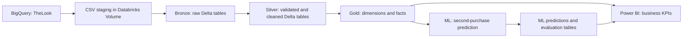

# End-to-End Business Intelligence and Predictive Analytics Solution using Databricks and Power BI

**Author: مهدیه سادات اسماعیلی (Mahdieh Sadat Esmaeili)**

Final Business Intelligence project | October 2026

An end-to-end e-commerce analytics solution that connects public source data, a Databricks Delta lakehouse, a dimensional warehouse, customer repurchase modeling, and a six-page Power BI report.

## Business problem

E-commerce teams need a consistent view of sales, profitability, customers, products, and order outcomes. They also need a practical way to prioritize first-time customers for retention activity. This project combines descriptive BI with predictive customer ranking to answer:

- Which countries, marketing channels, categories, brands, and products drive revenue and profit?
- How do sales, returns, and cancellations change over time?
- Which first-time customers should receive attention based on their second-purchase propensity?

TheLook is synthetic data. The findings demonstrate an analytical workflow rather than results from a live commercial operation.

## Repository contents

```text
BI-End-to-End-Ecommerce-Analytics/
├── README.md
├── .gitignore
├── docs/
│   ├── CAT_Project_Analysis_and_Results.pdf
│   ├── NvS_Reproducible_Project_Steps.pdf
│   └── PROJECT.pdf
├── databricks/
│   ├── BI_Final_Project.dbc
│   └── notebooks/
│       ├── 01_Bronze_Load.py
│       ├── 02_Data_Quality_Silver.py
│       ├── 03_Gold_Data_Model.py
│       └── 04_ML_Second_Purchase_Prediction.py
├── powerbi/
│   └── BI_Final_Project.pbix
└── data/
    └── README.md
```

The PDFs, PBIX, and DBC are unchanged copies of the submitted artifacts. The Python files export the DBC notebook commands in their stored execution order, with Databricks cell separators; executed outputs remain in the DBC. The separate presentation-ready IPYNB and local CSV exports are not included in this submission repository.

- [Analysis and results](docs/CAT_Project_Analysis_and_Results.pdf)
- [Detailed reproduction guide](docs/NvS_Reproducible_Project_Steps.pdf)
- [Six-page Power BI export](docs/PROJECT.pdf)
- [Interactive Power BI report](powerbi/BI_Final_Project.pbix)

## Data source

Source: Google BigQuery public dataset `bigquery-public-data.thelook_ecommerce`.

| Table | Purpose |
| --- | --- |
| `users` | Customer demographics, geography, and traffic source |
| `orders` | Order headers, customer keys, status, and lifecycle timestamps |
| `order_items` | Item-level transactions, product keys, and sale prices |
| `products` | Product attributes, category, brand, cost, and retail price |

Export these tables to CSV and stage them in a Databricks Volume. No complete CSV datasets are committed; see [data/README.md](data/README.md). A later public-data snapshot may produce different counts and model metrics.

## Architecture: Bronze → Silver → Gold



- **Bronze:** ingest CSV families, infer schemas, add `_ingested_at`, and persist raw Delta tables.
- **Silver:** check keys, missingness, and referential integrity; remove order-item rows without a matching order.
- **Gold:** create reusable customer, product, and date dimensions and order/item facts, with item-level revenue, cost, and profit.
- **ML outputs:** persist current customer scores, held-out test predictions, and model metrics for reporting and audit.

## Data quality checks

Checks include row counts, distinct primary keys, duplicate IDs, per-column null reports, and left-anti joins for missing users, orders, and products.

The submitted snapshot contains no duplicate primary keys, no orders without users, and no order items without products. It contains **60 orphan order-item rows across 43 order IDs**. An inner join to valid orders removes these rows in Silver.

| Entity | Bronze rows | Silver rows |
| --- | ---: | ---: |
| Users | 100,000 | 100,000 |
| Orders | 125,545 | 125,545 |
| Order items | 182,295 | 182,235 |
| Products | 29,120 | 29,120 |

## Dimensional model

| Gold table | Grain | Submitted rows |
| --- | --- | ---: |
| `dim_users` | One customer | 100,000 |
| `dim_products` | One product | 29,120 |
| `dim_date` | One calendar day | 2,821 |
| `fact_orders` | One order | 125,545 |
| `fact_order_items` | One order item | 182,235 |

Item financial fields are `revenue = sale_price`, `cost = product_cost`, and `profit = sale_price - product_cost`.

## Power BI semantic model

Power BI uses **Import mode** for the five Gold tables plus `ml_second_purchase_predictions` and `ml_second_purchase_model_metrics`. The test-predictions table stays in Databricks for audit.

Create date-only `OrderDate` columns in both facts and `FirstOrderDate` in predictions. Mark `dim_date[date]` as the Date table. Use one-to-many, single-direction relationships from dimensions to facts/predictions:

| Dimension key | Related column |
| --- | --- |
| `dim_date[date]` | `fact_order_items[OrderDate]` |
| `dim_products[id]` | `fact_order_items[product_id]` |
| `dim_users[id]` | `fact_order_items[user_id]` |
| `dim_date[date]` | `fact_orders[OrderDate]` |
| `dim_users[id]` | `fact_orders[user_id]` |
| `dim_date[date]` | `ml_second_purchase_predictions[FirstOrderDate]` |
| `dim_users[id]` | `ml_second_purchase_predictions[user_id]` |

Remove an automatically generated direct relationship between the two fact tables. Keep the model-metrics table disconnected; select its `final_test` row for final evaluation cards. Dashboard values depend on slicers and filter context.

## DAX KPIs

Representative measures reproduce the submitted report logic:

```dax
Total Revenue = SUM(fact_order_items[revenue])
Total Cost = SUM(fact_order_items[cost])
Total Profit = SUM(fact_order_items[profit])
Profit Margin % = DIVIDE([Total Profit], [Total Revenue], 0)
Total Items = COUNTROWS(fact_order_items)
Total Orders = DISTINCTCOUNT(fact_orders[order_id])
Total Customers = DISTINCTCOUNT(fact_orders[user_id])
Average Order Value = DIVIDE([Total Revenue], [Total Orders], 0)
Revenue per Customer = DIVIDE([Total Revenue], [Total Customers], 0)
Returned Orders = CALCULATE([Total Orders], fact_orders[status] = "Returned")
Cancelled Orders = CALCULATE([Total Orders], fact_orders[status] = "Cancelled")
Return Rate % = DIVIDE([Returned Orders], [Total Orders], 0)
Cancellation Rate % = DIVIDE([Cancelled Orders], [Total Orders], 0)
Customers Scored = DISTINCTCOUNT(ml_second_purchase_predictions[user_id])
Predicted Repurchase Customers =
    CALCULATE([Customers Scored], ml_second_purchase_predictions[predicted_repurchase] = 1)
Predicted Repurchase % = DIVIDE([Predicted Repurchase Customers], [Customers Scored], 0)
Average Repurchase Score = AVERAGE(ml_second_purchase_predictions[repurchase_probability])
```

Additional measures cover average customer age, completed/shipped/processing orders, opportunity segments, and final model-performance cards. The submitted full report shows approximately 10.86M revenue, 5.64M profit, and 51.9% margin. Revenue measures sum stored item values across the current filter context; the ML target's cancellation exclusion is a separate definition.

## Six Power BI report pages

| Page | Analytical focus |
| --- | --- |
| 01 Executive Overview | Revenue, profit, orders, customers, AOV, time, channel, country, and status |
| 02 Sales & Profit | Sales/profit trends and category/brand performance |
| 03 Customer & Marketing | Customer demographics, geography, channels, and revenue per customer |
| 04 Product Performance | Top products, revenue/profit scatter, and product details |
| 05 Orders & Returns | Order status, return/cancellation rates, and trends |
| AI - Repurchase Prediction | Customer scores, opportunity segments, geography, and model metrics |

## Machine learning objective and results

**Predict whether a first-time customer will make a second non-cancelled purchase within 180 days.**

Exclude cancelled orders, identify each customer's first and second non-cancelled purchases chronologically, and require a complete 180-day observation window for training labels. Features use only information available at or before the first order: basket value/composition, product attributes, margin, tenure, demographics, channel, and calendar features. Identifiers and future-derived fields are excluded.

The mature cohort contains **56,570 customers** with approximately **11.48%** positive labels. A chronological 70/15/15 split produces 39,602 Train, 8,484 Validation, and 8,484 Test rows. Fit preprocessing on Train only for model selection. Compare weighted Logistic Regression, Random Forest, and Gradient-Boosted Trees by Validation PR-AUC. Logistic Regression has the highest Validation PR-AUC (0.231); lock threshold **0.50**, then refit on Train + Validation and evaluate once on Test.

**Final selected model: Logistic Regression**

| Final test metric | Value |
| --- | ---: |
| ROC-AUC | **0.697** |
| PR-AUC | **0.334** |
| Precision | **30.6%** |
| Recall | **76.3%** |
| F1 | **0.436** |

The final test confusion matrix is TN=3,700, FP=3,034, FN=415, TP=1,335. The Test positive rate is 20.63%, so the PR-AUC baseline is approximately 0.206. These are submitted-run results, not newly executed metrics.

### Repurchase Score interpretation

**The Repurchase Score is used for ranking and prioritization, not as a calibrated probability.** Class weighting affects score calibration; a score of 0.70 should not be interpreted as a verified 70% chance of repurchase. The stored column name remains `repurchase_probability` for compatibility. Existing Low/Medium/High Repurchase Probability segment labels are also preserved, but should be interpreted as relative opportunity bands.

Observed Test repurchase rates are approximately 6.0% in the lowest score decile and 37.7% in the highest. Current scores cover 12,235 first-time customers without a second purchase and with incomplete outcome windows. Temporal target-rate changes make drift monitoring and recalibration necessary before operational probability use. Model associations do not establish causal marketing effects.

## Reproduce the project

1. **Prepare tools and permissions.** Use Google BigQuery, a Databricks workspace with Spark ML/PySpark, Unity Catalog Volume and Delta table permissions, and Power BI Desktop with the Databricks connector. Use a dedicated project environment: the supplied notebooks contain overwrite writes and a staging-file rename cell. Store authentication in your local credential manager or Databricks secret facilities.
2. **Acquire source data.** Export `users`, `orders`, `order_items`, and `products` from `bigquery-public-data.thelook_ecommerce` to CSV, splitting large tables into parts. Preserve the extraction date for comparisons with the submitted snapshot.
3. **Stage copies.** Upload copies to `/Volumes/workspace/default/bi_final_raw/`. The supplied Bronze notebook initially expects `users_*.csv.csv`, then renames duplicated `.csv.csv` extensions to `.csv`. For unchanged first-run execution, stage user files with the initial expected suffix and allow that later rename cell to run. For clean filenames or reruns, adjust the initial users glob to `users_*.csv` in your own imported working copy. Keep original local exports intact.
4. **Import notebooks.** Import `databricks/BI_Final_Project.dbc` or the four source `.py` notebooks. Set the current catalog to `workspace` and schema to `default` before each notebook, for example `spark.sql("USE CATALOG workspace")` and `spark.sql("USE SCHEMA default")`. If your environment differs, map the Volume and table names consistently in your own working copies.
5. **Run Bronze and complete its missing dependency.** Execute `01_Bronze_Load`. The submitted export loads `df_orders` but omits its explicit Delta write. After the orders load, run this additional cell in your working notebook:

   ```python
   from pyspark.sql.functions import current_timestamp
   (df_orders.withColumn("_ingested_at", current_timestamp())
       .write.format("delta").mode("overwrite")
       .saveAsTable("workspace.default.bronze_orders"))
   ```

6. **Run Silver with explicit aliases.** Execute the first load cell of `02_Data_Quality_Silver`. Before later cells reference `bronze_*`, run this additional cell; those aliases are not initialized in the submitted notebook:

   ```python
   bronze_users = users
   bronze_orders = orders
   bronze_order_items = order_items
   bronze_products = products
   ```

   Complete the checks and Silver writes. Verify that orphan items are excluded.
7. **Build Gold.** Run `03_Gold_Data_Model` and verify the five dimensions/facts, row counts, date range, and item financial fields.
8. **Train and score.** Run `04_ML_Second_Purchase_Prediction` in cell order. Check the mature cohort, chronological split, validation selection, locked threshold, and final Test metrics. The final cells persist `default.ml_second_purchase_predictions`, `default.ml_second_purchase_test_predictions`, and `default.ml_second_purchase_model_metrics`; submitted counts are 12,235, 8,484, and 6 respectively. Check unique scored first orders and scores in [0,1].
9. **Connect Power BI.** Open `powerbi/BI_Final_Project.pbix`, replace the data-source settings with your Databricks connection, authenticate locally, and refresh the seven imported tables. Apply the semantic-model relationships and date types described above if rebuilding the report from scratch. Keep credentials outside this repository.
10. **Validate delivery.** Confirm all six pages render, slicers filter the intended tables, no direct fact-to-fact relationship remains, and final-test cards match Databricks. Compare against the detailed NvS guide and the report PDF. Use notebook counts as the full-population reference.

The fresh-workspace corrections above are documented setup steps; the committed source notebook commands and original DBC remain preserved. Databricks execution and Power BI refresh require your external environment and were not rerun during repository preparation.

## Artifact preservation and security

Original project files are preserved outside this repository. Submission artifacts were copied and checked with SHA-256. No raw CSV exports, credentials, API keys, tokens, `.env` files, or private connection configuration should be committed. The `.gitignore` excludes common temporary/cache and credential files while retaining the final PBIX.

The PBIX is **29,199,121 bytes (27.85 MiB)**, below [GitHub's 100 MiB normal Git file limit](https://docs.github.com/en/repositories/working-with-files/managing-large-files/about-large-files-on-github). It is included directly. If a future PBIX exceeds this limit, configure Git LFS for `*.pbix` before committing that version.
